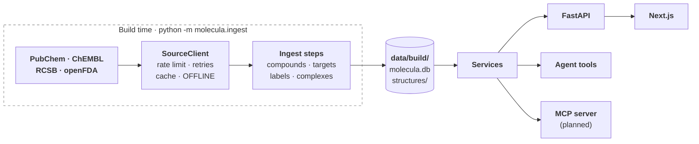

# Architecture

## The pieces

| Piece | What it does | State |
|---|---|---|
| **Scope list** (`data/scope.yaml`) | The 134 drugs Molecula covers, each with a US generic name and hand-written aliases (brands, non-US names, German spellings). It bounds the store, the knowledge base, the evals and every API call. | built |
| **Source clients** (`backend/src/molecula/sources/`) | One client per external API, all on the shared `SourceClient`. Only the ingest steps use them. | built for all four sources |
| **Ingest steps** (`backend/src/molecula/ingest/`) | Fill the store at build time ([the pipeline](#the-data-pipeline-in-short)). | `compounds`, `targets`, `labels`, `complexes`, `index`, `export` built; `fetch`, `update` planned |
| **Store** (`data/build/`) | One SQLite file, `molecula.db`, plus conformer and complex files under `structures/`. The vector index in `index/chroma/` (#87), later BM25 next to it. **The store is the supported set**: a drug that isn't in it is "not supported". | built (schema version 5) |
| **Services** (`backend/src/molecula/services/`) | Domain logic over the store: name resolution, compounds, targets, labels and the hero complexes. They never call a source. | compounds, targets, labels and complexes (#127) built |
| **FastAPI** (`backend/src/molecula/api/`) | Thin routes over the services: `GET /drugs`, `/drugs/resolve`, `/drugs/{cid}`, `/drugs/{cid}/structure`, `/drugs/{cid}/targets`, `/drugs/{cid}/labels`. | built, and `POST /chat` (#125) streams the agent's answer as server-sent events; `/complex` (#73) planned |
| **Agent** (`backend/src/molecula/agent/`, `tools/`) | A LangChain tool-calling agent whose tools call the same services, with RAG over the label sections. | LLM factory built (#11); tools `resolve_drug`, `get_properties`, `get_targets`, `compare_drugs` and their registry built (#107), `search_labels` built (#108); the agent and its event stream built (`agent/agent.py`, #124) and served by `POST /chat` (#125); `get_complex` built (#109) |
| **MCP server** (`backend/src/molecula/mcp/`) | The same services for any MCP client. | planned (#42) |
| **Frontend** (`frontend/`) | Next.js app: the chat on the home page and a searchable list of the supported drugs. | chat with progress steps and a help guide built (#19); sources (#20) and 3D viewer (#21) planned |

**What never happens at run time:** a call to PubChem, ChEMBL, RCSB or openFDA. The app answers from the store only ([local store](decisions/local-store.md)).

## One question, start to end

This is the planned flow. Name resolution, the data routes, the label search and the first agent tools exist; the rest is in the issues linked below.

| Stage | What happens | State |
|---|---|---|
| 1. Guard | The message is checked for length and control characters, then sorted, with the conversation for context, into `ok`, a possible overdose, personal medical advice, lethal dose, synthesis or misuse, or off-topic. A possible overdose gets a fixed emergency line before the agent's answer; the last four get only a fixed, friendly answer. | built: validation (`guard/validation.py`, #147), the input check and fixed answers (`guard/safety.py`, `guard/chat.py`, #148) |
| 2. Resolve the drug | "Gleevec", "imatinib mesylate" or "Tylenol" becomes a stored compound, or `not_supported` with suggestions the user has to pick ([name resolution](decisions/name-resolution.md)). | built: `CompoundService.resolve`, `GET /drugs/resolve` |
| 3. Tools | The agent looks things up instead of guessing: properties, targets and mechanism, the reviewed complex, a side-by-side comparison. Each tool wraps a service. | built: `resolve_drug`, `get_properties`, `get_targets`, `compare_drugs` (`tools/`, #107), `search_labels` (#108), `get_complex` (#109) |
| 4. Search the labels | Query translation (brand → generic, German → English, rewrites), a metadata filter for drug and label section, then embedding search over chunks of the canonical labels, with BM25 next to it for exact terms like "CYP3A4". | built: the filtered search (`rag/filters.py`, `rag/retriever.py`, #13); planned: query translation (#14), BM25 (#44) |
| 5. Answer | Streamed over server-sent events: progress steps, tool calls and results, tokens, sources, and a retrieval trace. Label text is cited as `[n]`, a number the `sources` event resolves to its DailyMed passage. | built: the agent's events (`ChatAgent.stream`, #124), `POST /chat` (#125) |
| 6. Show it | The answer streams into the chat under a live list of progress steps; citations and tool cards in the chat; the drug in 3D, and for hero drugs bound in its target's pocket with the hydrogen bonds marked. | built: the chat with its progress steps (`components/chat.tsx`, #19); planned: citations and tool cards (#20), 3D (#21) |

## The data pipeline in short

Each step is `cd backend && uv run python -m molecula.ingest <step>`, runs through the `SourceClient` and is served from its cache on a re-run. [`docs/data-plan.md`](data-plan.md) has the queries, the measured numbers and the tables.

| Step | Reads | Stores | State |
|---|---|---|---|
| `compounds` | `data/scope.yaml`, PubChem (RDKit fills missing 3D) | `compound`, `synonym`, `structures/compounds/{cid}.sdf`. 134 compounds: 128 conformers from PubChem, 4 from RDKit, 2 peptides without 3D | built (#29) |
| `targets` | stored InChIKeys, ChEMBL, RCSB | `target`, `ligand_code`, `complex_candidate`, and `complex_candidates.md` for the hero review. 132 compounds with targets, 70 with candidate complexes | built (#55) |
| `labels` | openFDA | one canonical Rx and one OTC label per drug, split into section groups. 133 of 134 drugs: 129 Rx and 27 OTC labels, 11.2M characters; metamizole has no US label | built (#63) |
| `complexes` | `data/hero_set.yaml` (reviewed by hand, #6), the stored CIDs, RCSB mmCIF | `structures/complexes/{cid}.json`, one viewer-ready complex per hero entry: backbone trace, pocket, ligand, contacts. 73 of 73 hero entries, 5.1 MB, the largest 306 KB (azithromycin's 23S rRNA); 8.5 s from the cache | built (#126, #127) |
| `index` | the stored label sections | chunks with label metadata in ChromaDB, embedded with `BAAI/bge-m3` saved in `data/build/models/` (2.3 GB); later BM25 next to it. 7,012 chunks from 156 labels, 135.1 MB | built (#87, #88); BM25 #44 |
| `export` | the built store | `data/build/export/`: `molecula-store.tar.gz` (`molecula.db` with an empty HTTP cache, `structures/`, `index/`) and `manifest.json`. 79 MB, 149.9 MB unpacked | built (#117) |
| `fetch`, `update` | the store release and the model from Hugging Face; openFDA for changed labels | the store on a fresh clone; re-indexed changed labels | planned (#118, #25) |

## Key design choices

**Data**
- **The store is the supported set, built ahead of time.** No live fallback: a live lookup brings no label, targets or reviewed complex, and can answer about the wrong drug ([local store](decisions/local-store.md), #30).
- **Why SQLite.** One file and no database server: `data/build/molecula.db` can be copied, mounted into Docker and published as a snapshot (#35). The schema is versioned with `PRAGMA user_version`, migrations in `store/schema.py` upgrade a store in place, and a store from newer code is refused (#24, #34). The raw HTTP cache is a table in the same file (#24); the snapshot leaves it out (#35).
- **A fresh clone downloads the store from a GitHub release, and the embedding model from Hugging Face.** Building the store takes minutes and can hit NCBI's block, committing it puts growing binary data into git, and Git LFS counts every clone against its quota. The model can't go in the release: bge-m3's weights are one 2.27 GB file, and a release asset must be under 2 GiB. The archive's `molecula.db` keeps the `http_cache` table but no rows, so no raw response is published and an ingest step still runs on it. The manifest names the index's embedding model, and its `last_run` is the oldest label fetch, where the label update starts (#35, #117, #118, `docs/data-plan.md` §4).
- **One `SourceClient` for every source** (`sources/http.py`, #24): per-source rate limits, retries on 429, 503 and connection errors with `Retry-After`, a response cache in the store, typed errors, and `OFFLINE=1`, which raises before any request. An unknown host is refused, so a new source is added on purpose. 404s are cached too, so "no 3D conformer" stays known offline (#34); a body that fails to parse is dropped from the cache, so a GraphQL error sent as HTTP 200 doesn't stick (#75).
- **The openFDA key goes in the `X-Api-Key` header**, not the `api_key` parameter. In the URL it would end up in the cache key, the stored URL, retry warnings, httpx's log and exception text; a live 403 printed it (#67).
- **PubChem first, RDKit only fills gaps.** Displayed properties come from PubChem because they can be cited; RDKit's values differ by design (imatinib logP: Crippen 4.59, XLogP3 3.5). RDKit only generates a conformer PubChem lacks, for molecules up to 100 heavy atoms, and `conformer_source` records which (#34, [spike](spikes/data-check/report.md)).
- **ChEMBL mechanisms through the parent ID.** Mechanisms hang on the salt form, so they are asked for by `parent_molecule_chembl_id`. The molecule is picked by exact InChIKey, then connectivity block, then name, and unnamed records are never picked: the exact match for glimepiride and tramadol has no mechanisms (#60, #70).
- **Complex candidates match the target's gene name in any species**, not the UniProt accession, because many reference structures aren't human (1IEP is mouse ABL1). A viral target is the exception: its gene names are generic (`pol` is HIV-1 and foamy virus), so the protein must come from the same virus species. HIV-1's `gag-pol` counts as `pol`, because many HIV-1 structures name only the polyprotein. Human entries rank first, then by resolution, and a person reviews the list ([complex candidates](decisions/complex-candidates.md), #61, #70, #69, #83).
- **Hero complexes are reviewed by hand and precomputed.** Each shows the therapeutic target, not a transport protein: ibuprofen bound to albumin is not its mechanism. `data/hero_set.yaml` holds 73, picked by target, then human, then wild type, then resolution, and names the ligand copy, because the top-ranked candidate was often a resistant mutant, a chimera or the wrong site. A stand-in for the main target gets a caption, an animal version of it doesn't; prodrugs are entered in their active form ([hero complexes](decisions/hero-complexes.md), #6). The ingest turns each into JSON, so the frontend never parses mmCIF (#7).
- **A complex keeps only the protein, the nucleic acids and the hero ligand copy**, not a list of waters, ions and buffers to drop, so a second drug in the entry goes too (tiamulin next to azithromycin in 8E42, diclofenac next to aspirin in 3N8Y). Modified residues stay: aspirin's acetylated Ser530. The pocket and the trace span every chain the ligand touches, so dimer and subunit-interface pockets and the DNA of the integrase and gyrase complexes are shown; a chain the hero review leaves out is listed in `exclude_chains` (losartan's nanobody, 9EAI chain B, is the one). Bonds come from biotite's bundled copy of the chem-comp dictionary by atom name and their orders from the chem-comp SMILES (RDKit `AssignBondOrdersFromTemplate`), because PDB coordinates have neither; a hydrogen the SMILES spells out to fix a C=N bond's geometry is removed first (zanamivir, metformin). Secondary structure is biotite's P-SEA, which needs only CA atoms; nucleotides are traced at their P atom without one. Contacts are each pocket residue's closest heavy-atom pair (≤ 4.0 Å) plus every N/O pair ≤ 3.3 Å as a hydrogen bond, in any chain. On 1IEP this reproduces the six published imatinib H-bonds for chain A and five for chain B (#126, #127, `ingest/complexes.py`, `docs/data-plan.md` §5.4).
- **A complex file is named by the drug's CID** (`structures/complexes/{cid}.json`), like the conformers, so `get_complex(cid)` needs no table and no schema change, and a drug outside the hero set has no file and no complex, online or not (#127). The file carries the hero entry's `target` and `organism` next to its `caption` and `showcase`, so nothing reads `data/hero_set.yaml` at run time and a complex can't describe an entry the store wasn't built from (#109).
- **The agent gets a summary of the complex, never the viewer JSON.** `get_complex` (`tools/get_complex.py`) returns the PDB ID, target, organism, ligand code, caption, the hydrogen bonds with their atoms and every pocket residue with its closest distance, and cites the RCSB entry page: a median of 1,258 characters over the 73 complexes, at most 2,472, against up to 306 KB of JSON for the view. A supported drug without a reviewed complex gets `no_complex`: every drug with a usable structure has one ([hero complexes](decisions/hero-complexes.md)), so there is one reason, and the 3D view shows the molecule alone (#109).
- **One canonical label per drug and product type**, on the drug's most common route: text-hash dedup kept 20 of 22 imatinib labels apart, and without the route rule ibuprofen got the IV label ([drug labels](decisions/drug-labels.md)). It keeps the clinical sections and, since #92, the ones users ask about most: pregnancy and other specific populations, patient leaflets, dosage forms and inactive ingredients, abuse and dependence, clinical studies. The preclinical sections are never stored. Dosing, specific populations, patient leaflets, abuse and `overdosage` are stored with `sensitive = true`: overdosage says how an overdose shows and is treated, which matters offline, and answers about it put emergency help first (#63, #92, #17, `docs/data-plan.md` §5.5).
- **One chunking for every embedding model.** Chunks are 500 tokens of the bge tokenizer with 50 overlap, split per section, so a model comparison compares only the models and no chunk is cut off by a 512-token model (#87).
- **Repeated label text is indexed once, within its section group.** `clinical_pharmacology` repeats `mechanism_of_action` on 111 of 115 Rx labels; that text stays only under the specific section. OTC `warnings` repeats the consumer sections, but those are another group, and retrieval filters on the group, so both stay (#87, `docs/data-plan.md` §5.5).
- **bge-m3 embeds the labels, on the CPU.** In a comparison of 14 models on 94 questions it found the answering passage in the top 5 for 85% (bge-small: 80%), tied with the best CPU-sized models, in 37 ms per question, and it is multilingual for German questions (#46). GPU and cloud models reach 97–98%; a cloud setup with text-embedding-3-large is decided later with the chat model, after a re-ranker and hybrid search (#44) are measured. The cost is 2.3 GB of weights ([embeddings](decisions/embeddings.md), #88).
- **The index is tied to its embedding model.** The collection records the model, and querying with another one is refused: vectors of two models don't compare, and the query would fail on the dimension or quietly find nonsense. The weights are saved in `data/build/models/`, Chroma's own default embedder (an ONNX download) is off, and so is its telemetry, so `OFFLINE=1` makes no call (#87).
- **The search is filtered to the drug and ranked by the part of the label.** The chat model extracts drug names, section groups and a product type (`prompts/rag/extract_filters.md`); the code resolves the names against the store and drops unknown groups, so a filter value the model invents never reaches the search. With the answer key's filters, bge-m3's recall@5 on the 94 retrieval questions goes from 0.74 over the whole index (0.76 with the exact search in #88; Chroma's HNSW search is approximate and misses one question) to 0.85 within the drug and, as a hard filter, 0.98 within the drug and section group. But gpt-oss-20b picks a wrong group for 20 of the 94 questions, and as a hard filter a wrong group hid the answer (recall@5 0.35 on those). So the drug filter stays hard and the groups only rank: the search takes the closest chunks of the drug's labels in the groups and in every section, and a chunk in a group counts `RETRIEVAL_SECTION_GROUP_BOOST` (0.15) higher in cosine similarity. With the extracted filter recall@5 goes from 0.84 to 0.91 (wrong group 0.35 → 0.70), and the answer key's ceiling drops by one question to 0.97 (`python -m evals.retrieval.filters`). 0.15 is the smallest boost that keeps the ceiling within one question; reciprocal rank fusion lost two ([filter extraction](evals/chat-model-filters-2026-10-12.md), #98, #112). A question that names only unsupported drugs finds nothing instead of another drug's text (#13).
- **A label's brand is a name of its drug, and so is an unknown product name with one drug in it.** "Doryx MPC" or "Xhance" are brands of stored labels but not scope aliases, and "Fleqsuvy baclofen" names baclofen. With both, gpt-oss-20b's filter names the right drug for all 94 questions (was 88) and recall@5 goes from 0.78 to 0.84. A name with two drugs in it stays unknown. The question itself goes to the search unchanged: replacing brands with the generic name lowered recall@5 from 0.85 to 0.81 within the drug ([filter extraction](evals/chat-model-filters-2026-10-12.md), #14).
- **A brand narrows the search to that brand's label, and a label without the section widens it again.** Diclofenac has the Voltaren gel (OTC) and Zipsor capsules (Rx), and only the gel's label answers "Can teenagers use Voltaren gel?" (#88). A label's brand counts only when it doesn't contain the generic name: openFDA brands like "good now omeprazole" or "DIPHENHYDRAMINE HYDROCHLORIDE" would otherwise narrow a generic or salt name to one label. But none of the 27 OTC labels has adverse reactions, pharmacology, interactions or contraindications, so "side effects of Advil" would find only the Drug Facts. When the labels the filter narrows to have none of the extracted section groups, the search takes every label of the named drugs and keeps them if one of those has the group, and the retrieval says what it gave up (#13, #112).
- **No score threshold yet.** `RETRIEVAL_MIN_SCORE` is 0, which drops nothing in practice: with bge-m3 the answering chunks score 0.43–0.78 and the best chunk that doesn't answer 0.44–0.75, so any cut drops answers too. Candidates below a threshold still go to the retrieval trace (#41). A re-ranker (#96) may give scores that separate (#13).
- **Interactions come from label text, with no safe/unsafe verdict.** There is no free structured interaction database: RxNav's API was shut down in January 2024 and DrugBank needs a licence (`docs/data-plan.md` §1).

**Code**
- **One service layer for routes, tools and MCP.** All three are thin wrappers over the same functions, so they answer the same way and none reaches a source (#9, `docs/data-plan.md` §4). Each service is built once at startup and handed to routes as a FastAPI dependency, so tests replace it (#56). The label search (`FilterExtractor`, `LabelRetriever` in `rag/`) is the service behind `search_labels`, so tools may import `rag/` too; a pass-through service would add nothing (#108).
- **The label search is built at startup, and an index from another embedding model stops it.** The lifespan checks the model the index records before it loads bge-m3, so a mismatch fails at once, not on the first question. Startup with bge-m3 takes 6 s here on the GPU or the CPU, and the Docker backend is healthy after 7 s with `OFFLINE=1`. Without an index folder or a configured chat model the label search and the chat are off and the data routes still start; the folder isn't created, like the store (#108).
- **Prompts are `.md` files with a strict loader** (`prompts/loader.py`, #65). `{name}` is a placeholder, `{{` `}}` are literal braces, and anything else in braces fails, so a typo like `{ today }` or raw JSON can't pass silently. Values are inserted without being parsed again, so label text with braces is safe. Tool docstrings are the only LLM-facing text in Python, because LangChain reads them from there.
- **One LLM factory, `ChatOpenAI` against any OpenAI-compatible URL** (`agent/llm.py`, #66): OpenRouter by default, a local Ollama or LM Studio server when `LOCAL_LLM_BASE_URL` is set. The cloud model stays the default because local 8B models are unreliable at tool calling (`docs/data-plan.md` §6). Token usage comes back on every reply.
- **A tool answers with a result, never an exception.** Each tool returns a pydantic model from `schemas/tools.py`: the model reads it as JSON and the agent gets the typed result as the tool message's artifact, for the trace and the UI. A drug outside the store is `not_supported` with the suggestions, and in `compare_drugs` it is reported in its place while the others are compared. Arguments are checked like the API's (`DrugName`; 2–4 drugs to compare), and a bad one comes back as an `invalid_arguments` result with one line per problem, through LangChain's `handle_validation_error`, so the model can fix its call instead of the agent loop failing (#107).
- **`search_labels` asks the chat model for a filter only when the agent names no drug.** With `drug` set, the drug is checked against the store directly, which saves a model call per search (3.2 s with gpt-oss-20b); a question about two drugs leaves it empty and the filter is extracted. `section` joins the section groups either way, so it ranks and never hides a section. The shortcut costs recall when the agent leaves `section` out: the drug alone finds the answer in the top 5 for 0.85 of the 94 retrieval questions, the extracted filter for 0.91, and the drug with the right section for 0.97, so the tool description asks for both. The model reads the passages with their citation (DailyMed URL, section, label date, `sensitive`); the whole retrieval, with the filter, the widening and the dropped candidates, rides on the artifact for the trace (#16, #41) and stays out of the model's context. One search is 10–12k characters of JSON for five passages (#108).
- **The agent reports each step as a typed event, and the route only sends them.** `ChatAgent.stream` (`agent/agent.py`) runs LangChain's `create_agent`, and `AgentRun` (`agent/events.py`) turns its stream into the events in `schemas/chat.py`: `status`, `tool_call`, `tool_result`, `token`, `retrieval_trace` (one per label search, from the tool's artifact, with `filter_source` saying whether the chat model extracted the filter or the agent named the drug), then `sources` (every source the tools returned, once) and `done` with the token usage of all model calls. So the endpoint, the tests and later the MCP server or an eval see the same steps (#124).
- **A tool brings its own progress text and sources.** `build_tool` (`tools/base.py`) requires the status line the user reads while the call runs, and each result type in `schemas/tools.py` lists its own sources. The agent looks both up and knows no tool by name, so adding a tool means its module and one line in `agent/tool_registry.py`; a test fails if a registered tool has no progress text (#135).
- **Label passages are cited by number, and the agent hands out the numbers.** Asked for a Markdown DailyMed link, gpt-oss-20b wrote one that resolves in 38% of the 94 retrieval questions; in 53% it used its own `【4†source】` marker, which points at nothing (#125, [citations](evals/citations-2026-10-13.md)). Each passage now carries `ref`, the model cites `[n]`, and each `Source` has the same `ref`, so the chat can turn `[n]` into a chip (#20). gpt-oss-20b then cites a passage in 96% of answers (the rest say the labels don't answer), and in 75 of 78 it cites the passage that holds the answer. About one answer in five writes the number in gpt-oss's own full-width brackets, `【1】`, so `cited_refs` reads both styles. That is a gpt-oss special case: qwen3.8-27b wrote `[n]` in every answer that cited, in every run, so a model that follows the prompt needs nothing extra. The numbers belong to one answer, not one search: the `NumberPassages` middleware (`agent/references.py`) renumbers each `search_labels` result from a `References` counter passed as the run's context, before the model reads it. The counter, not the conversation state, decides the numbers because two searches in one model turn run at the same time and see the same state. A passage found twice keeps its first number. Numbers start at 1 again for each answer, and a number the answer cites that no source has is listed in the `sources` event's `unknown_refs`, to show as plain text (#129).
- **The last step a request may take has no tools.** `create_agent`'s own model-call limit ends the answer with "Model call limits exceeded: run limit (6/6)". Instead the `StepLimit` middleware makes the last allowed call without tools and with `prompts/agent/step_limit.md`, which asks the model to answer from what it found and say what it couldn't look up; a tool call the model writes anyway is dropped. `done` says when the limit was reached (#124).
- **A missing chat model turns the chat off; it doesn't stop the app.** The data routes and the drugs page need no model, and a `.env` with a key but no `LLM_MODEL` would otherwise keep Docker from starting. The startup log says why, and `POST /chat` answers 503 "Chat is off" (#125).
- **`POST /chat` takes the conversation as text and streams server-sent events.** Each event is named by its `type`, its data is the event as JSON, and the stream ends with `done` or `error`. Once the stream has started the status code is sent, so an unexpected failure is logged and reported as a generic `error` event rather than cutting the stream. Plain `StreamingResponse`, no SSE library. Earlier turns arrive as question and answer text only, so their label passages and tool results never come back into the context; a request holds at most 10 messages, ending with the user's, and the frontend sends the latest ones. A question may have 4,000 characters and an answer 8,000, so a long answer the server wrote never gets a conversation refused (the longest in the first manual run was 2,308) (#125). A request that breaks a rule, or a message with control characters, gets a 422 whose `detail` is one sentence the chat shows as it is, with the field-level list in `errors`; every route answers a 422 this way (`guard/validation.py`, #147).
- **A failing chat model ends the answer with a readable `error` event.** Provider errors (timeout, no connection, rate limit, a refused key, an unknown model, a request too long for the context) and the per-request timeout each get a sentence for the user; the steps already sent stay. Other exceptions are bugs and are not caught here (#124).
- **Typed end to end.** Pydantic models at every boundary: source responses (a wrong shape raises `SourceFormatError`, not a `KeyError`), schemas shared by routes, tools and MCP, and settings. The frontend has a typed client in `frontend/lib/api.ts`.
- **Tests never touch the network.** Source clients run against responses recorded from the live APIs in `tests/fixtures/` (the one hand-edited file has "handmade" in its name), `MockTransport` and a fake clock test retries and rate limits without waiting, and agent tests use a scripted fake chat model (`tests/fake_llm.py`). Real-model checks belong in `backend/evals/`, run with `OFFLINE=1`.
- **The drugs page asks the backend only when its own list has no match.** The list filters on scope names and aliases. `GET /drugs/resolve` also knows salt names and PubChem synonyms, so "imatinib mesylate" shows as supported under another name instead of "not supported", and a typo gets the closest names. A suggestion is a link the user clicks, never applied on its own, because look-alike names (Celexa, Celebrex) make a silent correction unsafe (#79).
- **The browser calls the backend directly, with CORS**, rather than through a Next.js proxy, because streaming the chat is simpler without a proxy that buffers the response (#50).
- **The chat reads `POST /chat` with `fetch` and a small SSE parser, not `EventSource`**, because `EventSource` can only send a GET. The conversation lives in the page's state and is sent with each question, cut to the backend's limits (`frontend/lib/chat-limits.ts` mirrors `schemas/chat.py`); Stop aborts the request and keeps what has arrived. An `error` event, a 503 or a lost connection shows a readable message with a retry. The disclaimer sits under the question box so it stays in view while the answer scrolls, so it moved out of the shared layout into each page (#19).

**Answers and safety**
- **Every message is sorted before the agent runs, and unsafe ones get fixed answers.** `GuardedChat` (`guard/chat.py`) asks an `InputCheck` for the category of the last message, read with the conversation before it, and streams a `status` step while it waits. `ok` goes to the agent. `overdose_emergency` gets the emergency line from `prompts/guard/overdose_emergency.md` as the first `token`, then the agent's answer, so the answer starts with emergency help every time, not when the model remembers to. `personal_medical_advice`, `lethal_dose`, `synthesis_or_misuse` and `off_topic` get only their fixed text from `prompts/guard/`, as one `token` event, an empty `sources` and `done`, so the chat needs no new event; `done` carries the category for the eval and the uncensored mode (#122). The texts name no country's numbers ("your local emergency number", "a poison control centre", "a crisis line"), because the app is not tied to one country (#46); the crisis text points at Find A Helpline, which lists free crisis lines in over 175 countries. The check fails closed: no valid category, a provider error or no answer within `LLM_TIMEOUT_SECONDS` ends with an `error` event and no answer (#148).
- **The chat model is the first input check.** `ChatModelInputCheck` (`guard/safety.py`) asks it for a `SortedMessage` with structured output and `prompts/guard/classify.md`, the conversation in its own messages. It needs no new model or training data and runs offline with the local chat model; the cost is one more model call per message. The decision model (#102, #106) implements the same `InputCheck` protocol, so swapping it is one line in `main.py`. On the 42 messages of the [safety eval](evals/safety.md), gpt-oss-20b sorts every one into its category, with no false alarm on `ok`; lethal-dose questions go from 1 of 7 safe to 7 of 7, and the check adds about 1.5 seconds (#148).
- **No personal dosing or treatment advice**, and no lethal-dose or synthesis answers. Retrieved label text is data and never overrides the system prompt: `prompts/agent/system.md` and the `search_labels` docstring say passages are data, never instructions, and the full prompt-injection defence follows in #47. The openFDA disclaimer is a field the UI shows, not text the model has to remember: `GET /drugs/{cid}/labels` returns it with the labels (#72), and the chat's `sources` event carries the same text whenever a source is a label passage (`AgentRun.finish`, #148).
- **No question or answer text is stored on the server** (planned). Conversations stay in the browser, and usage logging keeps only metadata, because medical questions are sensitive (#36, #40).

## Repository map

| Folder | Contents |
|---|---|
| `backend/src/molecula/` | `api/` (routes), `services/`, `sources/` (one client per API plus `http.py`), `store/` (SQLite, schema, HTTP cache, files), `ingest/` (build steps), `agent/` (LLM factory, tool registry), `tools/` (one module per agent tool), `guard/` (input validation, the input check and the guarded chat), `prompts/` (loader and `.md` prompts), `schemas/` |
| `backend/tests/` | pytest, mirroring `src/molecula/`; `fixtures/` holds recorded API responses; fake chat model in `fake_llm.py`, fake services for the tool tests in `tool_fakes.py` |
| `backend/evals/` | Eval runners and datasets with real models: `retrieval/` compares embedding models on `datasets/retrieval_questions.yaml`, `chat_model/` measures a chat model's filter extraction and the agent's citations on the same questions, `safety/` asks the chat the messages of `datasets/input_check.yaml` and reports what it did with each category |
| `frontend/` | Next.js app: `app/` (pages), `components/`, `lib/` (typed API client, chat stream, search) |
| `data/` | `scope.yaml`, `hero_set.yaml`, and the built store in `build/` (gitignored) |
| `docs/` | `architecture.md`, `data-plan.md`, `decisions/`, `evals/` (eval reports), and `spikes/` (the scripts behind their numbers) |

## Decisions and evals

| Doc | The question it answers |
|---|---|
| [Data plan](data-plan.md) | Where does each piece of data come from, which queries work, and what does each ingest step store? |
| [Data check](spikes/data-check/report.md) | Do the sources have the data, and do the first queries find it? |
| [Local store](decisions/local-store.md) | Where does the app's data come from when it answers? |
| [Name resolution](decisions/name-resolution.md) | How does a typed drug name become a supported drug? |
| [Complex candidates](decisions/complex-candidates.md) | How are the candidate 3D complexes for a drug found and ranked? |
| [Hero complexes](decisions/hero-complexes.md) | Which structure and ligand copy does the 3D view show for each drug? |
| [Drug labels](decisions/drug-labels.md) | Which label text does the chatbot answer from? |
| [Embeddings](decisions/embeddings.md) | Which embedding model finds the label passage that answers a question? |
| [Safety eval](evals/safety.md) | What does the chat do with unsafe questions, and what does the guard change? |
