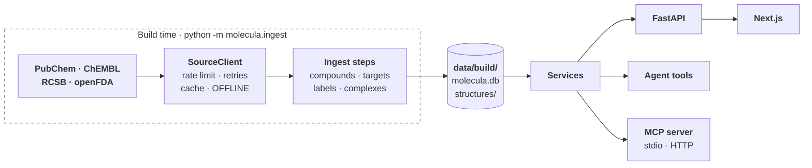

# Architecture

How Molecula is put together, in a few minutes. Each section links to the detail: the full reasoning behind every design choice is in `docs/design/`, the big questions with their evidence in `docs/decisions/`, and the eval reports in `docs/evals/`.

## The pieces

| Piece | What it does |
|---|---|
| **Scope list** (`data/scope.yaml`) | The 133 drugs Molecula covers, each with a US label, each with a US generic name and hand-written aliases (brands, non-US names, German spellings). It bounds the store, the knowledge base, the evals and every API call. |
| **Source clients** (`backend/src/molecula/sources/`) | One client per external API, all on the shared `SourceClient`. Only the ingest steps use them. |
| **Ingest steps** (`backend/src/molecula/ingest/`) | Fill the store at build time ([the pipeline](#the-data-pipeline-in-short)), download a built store (`fetch`) and keep its labels current (`update`). |
| **Store** (`data/build/`) | One SQLite file, `molecula.db`, plus conformer and complex files under `structures/`, the vector index in `index/chroma/` and the BM25 index `index/bm25.db` next to it. **The store is the supported set**: a drug that isn't in it is "not supported". |
| **Services** (`backend/src/molecula/services/`) | Domain logic over the store: name resolution, compounds, targets, labels and the hero complexes. They never call a source. |
| **FastAPI** (`backend/src/molecula/api/`) | Thin routes over the services: `GET /drugs`, `/drugs/resolve`, `/drugs/{cid}` with its `/structure`, `/targets`, `/complex` and `/labels`; `POST /chat`, which streams the agent's answer as server-sent events; and `/stats`, `/models`, `/retrieval` for the pages around the chat. |
| **Guard** (`backend/src/molecula/guard/`) | Stands in front of the agent: sorts each message, gives unsafe ones a fixed answer, stops an answer that leaks the system prompt, and checks each answer against its sources once it has streamed. |
| **Agent** (`backend/src/molecula/agent/`, `tools/`) | A LangChain tool-calling agent with six tools (`resolve_drug`, `get_properties`, `get_targets`, `get_complex`, `search_labels`, `compare_drugs`) that call the same services, with RAG over the label sections. |
| **MCP server** (`backend/src/molecula/mcp/`) | The agent's six tools for any MCP client (MCP Inspector, Claude Desktop): `python -m molecula.mcp` over stdio, streamable HTTP with `docker compose --profile mcp`. The chat calls its tools through it too. |
| **Frontend** (`frontend/`) | Next.js app: the chat with an evidence panel beside each answer (steps, sources, the 3D view, the answer's flow), a searchable list of the supported drugs, the benchmarks, a dashboard and a guide to how an answer is made. |

**What never happens at run time:** a call to PubChem, ChEMBL, RCSB or openFDA. The app answers from the store only ([local store](decisions/local-store.md)). The one exception is the label update (#342): the backend asks openFDA once a night, or when the owner presses Update now, whether the stored labels changed, and writes what it finds into the store; an answer still never waits on openFDA.

## One question, start to end

| Stage | What happens | Code |
|---|---|---|
| 1. Guard | The message is checked for length and control characters, then sorted, with the conversation for context, into `ok`, a possible overdose, personal medical advice, lethal dose, synthesis or misuse, prompt injection, or off-topic. A possible overdose gets a fixed emergency line before the agent's answer; the last five get only a fixed, friendly answer. | `schemas/chat.py`, `guard/validation.py`, `guard/safety.py`, `guard/chat.py` |
| 2. Resolve the drug | "Gleevec", "imatinib mesylate" or "Tylenol" becomes a stored compound, or `not_supported` with suggestions the user has to pick ([name resolution](decisions/name-resolution.md)). | `CompoundService.resolve`, `GET /drugs/resolve` |
| 3. Tools | The agent looks things up instead of guessing: properties, targets and mechanism, the reviewed complex, a side-by-side comparison. Each tool wraps a service. | `tools/`, `agent/tool_registry.py` |
| 4. Search the labels | A metadata filter for drug and label section, with brands and German names recognised in it, then embedding search over chunks of the canonical labels. BM25 keyword search next to it, merged by reciprocal rank fusion, is a setting (`RETRIEVAL_MODE=hybrid`), off because it found less. German → English translation and multi-query rewrites are a setting too (`QUERY_TRANSLATION`), off because they gained 3 and lost 5 of 94. | `rag/filters.py`, `rag/translation.py`, `rag/retriever.py`, `store/keywords.py` |
| 5. Answer | Streamed over server-sent events: progress steps, tool calls and results, tokens, sources, and a retrieval trace. Facts are cited as `[n]`, a number the `sources` event resolves to its DailyMed passage or data page. Once the answer is out, a source check marks each claim as backed by the result it cites, held by another returned result, or in none. | `agent/agent.py`, `api/chat.py`, `guard/source_check.py` |
| 6. Show it | The answer streams into the chat under a live line for the current step; citations in the chat, tool cards in the evidence panel; the drug in 3D, and for hero drugs bound in its target's pocket with the hydrogen bonds marked. | `components/chat.tsx`, `components/evidence-panel.tsx`, `components/structure/` |

## The data pipeline in short

Each step is `cd backend && uv run python -m molecula.ingest <step>`, calls its sources through the `SourceClient` and is served from its cache on a re-run (`index`, `export` and `fetch` call no source; `update` always asks openFDA afresh). [`docs/data-plan.md`](data-plan.md) has the queries, the measured numbers and the tables.

| Step | Reads | Stores |
|---|---|---|
| `compounds` | `data/scope.yaml`, PubChem (RDKit fills missing 3D) | `compound`, `synonym`, `structures/compounds/{cid}.sdf`. 133 compounds: 127 conformers from PubChem, 4 from RDKit, 2 peptides without 3D |
| `targets` | stored InChIKeys, ChEMBL, RCSB | `target`, `ligand_code`, `complex_candidate`, and `complex_candidates.md` for the hero review. 131 compounds with targets, 69 with candidate complexes |
| `labels` | openFDA | one canonical Rx and one OTC label per drug, split into section groups. all 133 drugs: 129 Rx and 27 OTC labels, 11.2M characters |
| `complexes` | `data/hero_set.yaml` (reviewed by hand, #6), the stored CIDs, RCSB mmCIF | `structures/complexes/{cid}.json`, one viewer-ready complex per hero entry: backbone trace, pocket, ligand, contacts. 73 of 73 hero entries, 5.1 MB, the largest 306 KB (azithromycin's 23S rRNA); 8.5 s from the cache |
| `index` | the stored label sections | chunks with label metadata in ChromaDB, embedded with `BAAI/bge-m3` saved in `data/build/models/` (2.3 GB), and the same chunks in a BM25 index (SQLite FTS5, `index/bm25.db`, 24 MB). 7,012 chunks from 156 labels |
| `export` | the built store | `data/build/export/`: `molecula-store.tar.gz` (`molecula.db` with an empty HTTP cache, `structures/`, `index/`) and `manifest.json`. 88.6 MB, 179.2 MB unpacked (`store-2026-10-21`) |
| `fetch` | the pinned store release (`STORE_RELEASE`) and `BAAI/bge-m3` at a pinned revision from Hugging Face; only what is missing, whatever `OFFLINE` says | `molecula.db`, `structures/` and `index/` from the release (88.6 MB download), the model in `data/build/models/` (2.29 GB) |
| `update` | openFDA: which stored labels were withdrawn or have a new version, then all labels of those drugs | their labels and chunks replaced, the run in `label_update`. 9 requests and 3 s when nothing changed; as a command with the backend stopped, or inside the backend every night |

## Key design choices

One line each; the full reasoning, numbers and issues are on the design page named after each group.

**Data** ([details](design/data.md))
- **The store is the supported set, built ahead of time**, with no live fallback: a live lookup brings no label, targets or reviewed complex, and can answer about the wrong drug ([local store](decisions/local-store.md)).
- **One SQLite file with a versioned schema**, so it can be copied, mounted into Docker and published. A fresh clone downloads it from a GitHub release and bge-m3 from Hugging Face, both checked by SHA-256.
- **One `SourceClient` for every source**: rate limits, retries, a response cache in the store, typed errors, and `OFFLINE=1` refuses every request.
- **PubChem first, RDKit only fills gaps**, because displayed properties should be citable.
- **One canonical label per drug and product type**, on the drug's most common route; preclinical sections are never stored and sensitive ones are flagged ([drug labels](decisions/drug-labels.md)).
- **Labels stay current**: every night the backend asks openFDA which chosen labels were withdrawn or replaced, and fetches and re-indexes only those drugs ([label update](decisions/label-update.md)).

**3D structures** ([details](design/structures.md))
- **Hero complexes are reviewed by hand and show the therapeutic target**, not a transport protein: 73 entries in `data/hero_set.yaml` ([hero complexes](decisions/hero-complexes.md)).
- **Candidates match the target's gene name in any species**, because many reference structures aren't human; a viral target must come from the same virus ([complex candidates](decisions/complex-candidates.md)).
- **The ingest precomputes one viewer-ready JSON per drug**: the protein, nucleic acids, the drug, the metals and cofactors it binds through, the pocket and the contacts, so the frontend never parses mmCIF.
- **The agent gets a summary of the complex, never the viewer JSON**: a median of 1,258 characters against up to 306 KB.
- **3Dmol.js, bundled with the app, draws it in the evidence panel**, with the pocket and the hydrogen bonds marked.

**Label search** ([details](design/search.md))
- **bge-m3 embeds the labels, on the CPU**: the answering passage in the top 5 for 85% of 94 questions, tied with the best CPU-sized models. A server too small for it embeds with gemini-embedding-2 in the cloud ([embeddings](decisions/embeddings.md)).
- **The search is filtered to the drug and ranked by the part of the label**: the drug filter is hard, the section groups only add 0.15 to a chunk's similarity, because a wrong group as a hard filter hid the answer.
- **A brand is a name of its drug and narrows the search to its label**; a label without the asked-for section widens it again.
- **A search for several drugs searches each one** and keeps 5 passages per drug, so one drug can't take every slot.
- **Measured and left out by default**: query translation, multi-query and hybrid BM25 search, each a setting that is off, and a score threshold ([hybrid search](decisions/hybrid-search.md), [query translation](evals/query-translation-2026-10-16.md)).

**Agent, models and tools** ([details](design/agent.md))
- **One service layer for routes, tools and MCP**, so all three answer the same way and none reaches a source.
- **A tool answers with a typed result, never an exception**, and the chat calls the tools through Molecula's own MCP server, so the server is proven end to end.
- **gpt-oss-20b answers locally, gpt-6-luna in the cloud**, through one factory for any OpenAI-compatible URL; `OFFLINE` switches between them ([chat model](decisions/chat-model.md)).
- **Every fact is cited by number**: the agent numbers each source per answer, and a sentence about a drug that can't be cited is left out.
- **The agent reports each step as a typed event**, and `POST /chat` streams them as server-sent events, ending with the tokens and cost of each step.
- **Prompts are `.md` files with a strict loader**; tool docstrings are the only LLM-facing text in Python.

**Answers and safety** ([details](design/safety.md))
- **Every message is sorted before the agent runs** (Jev online, the chat model offline): a possible overdose gets emergency help first, and personal advice, lethal doses, synthesis, prompt injection and off-topic questions get a fixed answer in the question's language ([safety eval](evals/safety.md)).
- **Prompt injection is stopped at the input check, and control tokens never reach a model** ([prompt injection](evals/injection.md)).
- **Every answer is checked against its sources after it streams, and marked, never cut** ([answer check](decisions/answer-check.md)).
- **An answer that repeats the system prompt is stopped** before the leak goes out, by a canary in the prompt.
- **The agent writes no phone number but 911 and 112**, and an overdose answer gives the signs and leaves the treatment to doctors.
- **A prompt change runs a quick safety eval that a script scores**; a change to the guard runs the full one with verdicts by hand.

**The app** ([details](design/app.md))
- **The browser calls the backend directly** and reads the chat's stream with `fetch` and a small SSE parser.
- **The evidence behind an answer sits in a panel beside the chat**: its steps with each tool's result, its sources, the 3D view and its flow. Citations become named chips.
- **The source check shows as a badge under the answer and underlines in it.**
- **Conversations are kept in the browser's IndexedDB**; no question or answer text is stored on the server.
- **The interface is in German or English**, with an "instrument" look the owner picked from clickable prototypes.

**Running and deploying** ([details](design/operations.md))
- **`.env.example` is filled in for a new machine, with working values**, and shows every other default as a commented line.
- **`POST /chat` has a request limit per client and a daily cost limit, on by default.**
- **A deployed app sits behind a Clerk login in waitlist mode** and runs on Coolify from a compose file of its own ([setup](setup.md)).
- **Each chat request goes into a usage log with metadata only**, which feeds the dashboard.

## Repository map

| Folder | Contents |
|---|---|
| `backend/src/molecula/` | `main.py` (the FastAPI app), `wiring.py` (builds its parts and the MCP server's), `api/` (routes), `services/`, `sources/` (one client per API plus `http.py`), `store/` (SQLite, schema, HTTP cache, files), `ingest/` (build steps), `agent/` (LLM factory, tool registry), `tools/` (one module per agent tool), `guard/` (input validation, the input check, the guarded chat, and the source check that judges an answer's claims against its tool results), `prompts/` (loader and `.md` prompts), `schemas/` |
| `backend/tests/` | pytest, mirroring `src/molecula/`; `fixtures/` holds recorded API responses; fake chat model in `fake_llm.py`, fake services for the tool tests in `tool_fakes.py` |
| `backend/evals/` | Eval runners and datasets with real models, one folder per suite: `retrieval/`, `chat_model/`, `multilang/`, `safety/`, `decisions/`, `injection/`, `rag/`. The table below lists what each measured. |
| `frontend/` | Next.js app: `app/` (pages), `components/`, `lib/` (typed API client, chat stream, search) |
| `data/` | `scope.yaml`, `hero_set.yaml`, and the built store in `build/` (gitignored) |
| `docs/` | `architecture.md` (this page), `setup.md`, `data-plan.md`, `design/` (the full reasoning behind each design choice), `decisions/`, `evals/` (eval reports), and `spikes/` (the scripts behind their numbers) |

## Decisions and evals

| Doc | The question it answers |
|---|---|
| [Data plan](data-plan.md) | Where does each piece of data come from, which queries work, and what does each ingest step store? |
| [Data check](spikes/data-check/report.md) | Do the sources have the data, and do the first queries find it? |
| [Local store](decisions/local-store.md) | Where does the app's data come from when it answers? |
| [Name resolution](decisions/name-resolution.md) | How does a typed drug name become a supported drug? |
| [Complex candidates](decisions/complex-candidates.md) | How are the candidate 3D complexes for a drug found and ranked? |
| [Hero complexes](decisions/hero-complexes.md) | Which structure and ligand copy does the 3D view show for each drug? |
| [Drug labels](decisions/drug-labels.md) | Which label text does the chatbot answer from? |
| [Label update](decisions/label-update.md) | Which labels does an update fetch again? Only those of drugs whose chosen label was withdrawn or has a new version: 9 requests for 133 drugs. A window on the effective date needs weeks of margin, because openFDA publishes labels late, and then marked 110 drugs and about 1.85 GB |
| [Embeddings](decisions/embeddings.md) | Which embedding model finds the label passage that answers a question? |
| [Hybrid search](decisions/hybrid-search.md) | Does BM25 next to the embeddings, merged by reciprocal rank fusion, find the answering passage more often? No: 76 of 94 against 78 on the agent's searches; it helps a little with exact terms such as CYP3A4, so it is a setting, off by default |
| [Safety eval](evals/safety.md) | What does the chat do with unsafe questions, and what does the guard change? |
| [Prompt injection](evals/injection.md) | Which injection attacks get past the chat, and what do the defences change? 6 of 32 on `main`, 1 after #329 (a code word the user asks for). Before: instructions attached to a real medicine question with a fake `[SYSTEM]` note or tool result, gpt-oss's chat markup in a label passage, and code words set up in an earlier turn. The input check stops every request for the system prompt and all 9 forged histories; no attack broke a safety rule. 7 forged answers before an `ok` question (#204) primed nothing: every answer gave the label's figure, so history stays unsigned |
| [Drug without a label](evals/no-label-2026-10-14.md) | How does the chat answer about metamizole, which has no US label? Three fixes tried, none beat main; gpt-5-mini passes with no change, gpt-oss-20b at more reasoning doesn't |
| [Drugs without a US label](decisions/drugs-without-label.md) | Should Molecula keep a drug it has no US label for? No: metamizole was removed, so every supported drug has one |
| [Answers from memory](evals/from-memory-2026-10-14.md) | Do answers about drugs with a label add facts no passage holds, and does more reasoning change it? About one in five does; medium effort doesn't help |
| [Answer check](decisions/answer-check.md) | Can gpt-oss-20b judge an answer's claims against their sources, and what should the chat do with the verdict? It catches 85% of unsupported claims and wrongly rejects 3%, but only 6 or 7 of 17 that carry a citation; letting only checked answers through cost half the answers a fallback, so the chat marks claims instead |
| [Source check eval](evals/source-check-2026-10-14.md) | How well does gpt-oss-20b judge 181 hand-labelled claims, with two prompts and at medium effort? |
| [Decision model as the input check](evals/input-check-decision-2026-10-16.md) | Do Jev and Kev sort the guard's messages as well as gpt-oss-20b, and how fast? |
| [The input check on the larger test set](evals/input-check-larger-set-2026-10-19.md) | Do Jev and gpt-oss-20b still sort right on 280 messages with follow-ups and hard pairs? |
| [Decision model as the label filter](evals/label-filter-decision-2026-10-19.md) | Can Jev fill the label filter as well as gpt-oss-20b, with the drug names found by code? recall@5 0.90 against 0.91 in 0.27 s against 3.2 s; misspelled names come back "did you mean" where gpt-oss-20b corrects half of them |
| [Chat model](decisions/chat-model.md) | Which model answers locally and in the cloud, and how do gpt-6-luna, claude-haiku-5.5 and glm-4.7-flash compare with gpt-oss-20b? |
| [Query translation](evals/query-translation-2026-10-16.md) | Does translating a German question or adding rewrites make the label search find the answer more often? Translation wins back 3 of 94 questions for ~4 s per search, rewrites lose 5; both are built as the setting `QUERY_TRANSLATION` (#446), off by default |
| [German against English answers](evals/multilang.md) | Does a German question get as good an answer as its English original? Yes on gpt-oss-20b: 44 of 44 German answers in German, the answering passage found for 43 of 44 (English 42 of 45), 0.82 of claims supported (English 0.77) |
| [Unknown drug names](evals/not-found-2026-10-16.md) | How does the chat answer a misspelled or unknown drug name? With "I couldn't find it, did you mean …?" in 24 of 30 answers after #190, against 4 of 30 on main, where it said there was no data or corrected the typo itself |
| [Comparisons](evals/comparisons-2026-10-17.md) | Does a comparison of two drugs, or a 3D view plus a comparison, look up each drug's label? At gpt-oss-20b's default effort the 3D questions never did; the answers now reason at medium |
| [3D in a follow-up](evals/followup-3d-2026-10-18.md) | Does a 3D request in a follow-up turn call `get_complex`? Yes, 25 of 25 on gpt-oss-20b, so #173 no longer shows |
| [Reasoning before tool calls](evals/tool-call-reasoning-2026-10-19.md) | Why does gpt-oss-20b garble its third tool call, and what stops it? Its reasoning is lost between calls; listing the earlier results after the question stops it without the citation cost of sending reasoning back |
| [RAG answers](evals/rag-2026-10-19.md) | How faithful and relevant are the agent's answers, judged with RAGAs, and does a larger top_k return the answer more often? Faithfulness 0.86, answer relevancy 0.80; 11% of statements aren't in the passages read; top_k 10 returns the answer for 85 of 94 questions against 78 at 5, for twice the text |
