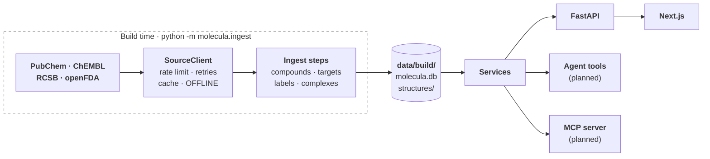

# Architecture

## The pieces

| Piece | What it does | State |
|---|---|---|
| **Scope list** (`data/scope.yaml`) | The 134 drugs Molecula covers, each with a US generic name and hand-written aliases (brands, non-US names, German spellings). It bounds the store, the knowledge base, the evals and every API call. | built |
| **Source clients** (`backend/src/molecula/sources/`) | One client per external API, all on the shared `SourceClient`. Only the ingest steps use them. | built for all four sources |
| **Ingest steps** (`backend/src/molecula/ingest/`) | Fill the store at build time ([the pipeline](#the-data-pipeline-in-short)). | `compounds`, `targets`, `labels` built; `complexes`, `index` planned |
| **Store** (`data/build/`) | One SQLite file, `molecula.db`, plus conformer and complex files under `structures/`. The vector index in `index/chroma/` (#87), later BM25 next to it. **The store is the supported set**: a drug that isn't in it is "not supported". | built (schema version 5) |
| **Services** (`backend/src/molecula/services/`) | Domain logic over the store: name resolution, compounds, targets; later labels and complexes. They never call a source. | compounds, targets built |
| **FastAPI** (`backend/src/molecula/api/`) | Thin routes over the services: `GET /drugs`, `/drugs/resolve`, `/drugs/{cid}`, `/drugs/{cid}/structure`, `/drugs/{cid}/targets`, `/drugs/{cid}/labels`. | built; `/complex` (#73) and `POST /chat` (#16) planned |
| **Agent** (`backend/src/molecula/agent/`, `tools/`) | A LangChain tool-calling agent whose tools call the same services, with RAG over the label sections. | LLM factory built (#11); tools (#15) and agent (#16) planned |
| **MCP server** (`backend/src/molecula/mcp/`) | The same services for any MCP client. | planned (#42) |
| **Frontend** (`frontend/`) | Next.js app. Today: the backend's health and a searchable list of the supported drugs. | chat (#19), sources (#20) and 3D viewer (#21) planned |

**What never happens at run time:** a call to PubChem, ChEMBL, RCSB or openFDA. The app answers from the store only ([local store](decisions/local-store.md)).

## One question, start to end

This is the planned flow. Name resolution and the data routes exist; the rest is in the issues linked below.

| Stage | What happens | State |
|---|---|---|
| 1. Guard | The message is checked for length and content, then sorted into `ok`, personal medical advice, lethal dose, synthesis or misuse, or off-topic. Anything but `ok` gets a fixed, friendly answer. | planned (#17) |
| 2. Resolve the drug | "Gleevec", "imatinib mesylate" or "Tylenol" becomes a stored compound, or `not_supported` with suggestions the user has to pick ([name resolution](decisions/name-resolution.md)). | built: `CompoundService.resolve`, `GET /drugs/resolve` |
| 3. Tools | The agent looks things up instead of guessing: properties, targets and mechanism, the reviewed complex, a side-by-side comparison. Each tool wraps a service. | planned (#15); the data behind properties and targets is served |
| 4. Search the labels | Query translation (brand → generic, German → English, rewrites), a metadata filter for drug and label section, then embedding search over chunks of the canonical labels, with BM25 next to it for exact terms like "CYP3A4". | planned (#13, #14; BM25 #44); the chunks are indexed (#87) |
| 5. Answer | Streamed over server-sent events: progress steps, tool calls and results, tokens, sources, and a retrieval trace. Label text is cited with a link to DailyMed. | planned (#16) |
| 6. Show it | Citations and tool cards in the chat; the drug in 3D, and for hero drugs bound in its target's pocket with the hydrogen bonds marked. | planned (#19, #20, #21) |

## The data pipeline in short

Each step is `cd backend && uv run python -m molecula.ingest <step>`, runs through the `SourceClient` and is served from its cache on a re-run. [`docs/data-plan.md`](data-plan.md) has the queries, the measured numbers and the tables.

| Step | Reads | Stores | State |
|---|---|---|---|
| `compounds` | `data/scope.yaml`, PubChem (RDKit fills missing 3D) | `compound`, `synonym`, `structures/compounds/{cid}.sdf`. 134 compounds: 128 conformers from PubChem, 4 from RDKit, 2 peptides without 3D | built (#29) |
| `targets` | stored InChIKeys, ChEMBL, RCSB | `target`, `ligand_code`, `complex_candidate`, and `complex_candidates.md` for the hero review. 132 compounds with targets, 70 with candidate complexes | built (#55) |
| `labels` | openFDA | one canonical Rx and one OTC label per drug, split into section groups. 133 of 134 drugs: 129 Rx and 27 OTC labels, 11.2M characters; metamizole has no US label | built (#63) |
| `complexes` | `data/hero_set.yaml` (reviewed by hand, #6), RCSB mmCIF | one viewer-ready JSON per hero complex: CA trace, pocket, ligand, contacts | planned (#7) |
| `index` | the stored label sections | chunks with label metadata in ChromaDB, embedded with a local model saved in `data/build/models/`; later BM25 next to it. 7,012 chunks from 156 labels, 106.9 MB | built (#87); model choice #88, BM25 #44 |
| `export` / `fetch`, `update` | the built store; openFDA for changed labels | a release snapshot for fresh clones; re-indexed changed labels | planned (#35, #25) |

## Key design choices

**Data**
- **The store is the supported set, built ahead of time.** No live fallback: a live lookup brings no label, targets or reviewed complex, and can answer about the wrong drug ([local store](decisions/local-store.md), #30).
- **Why SQLite.** One file and no database server: `data/build/molecula.db` can be copied, mounted into Docker and published as a snapshot (#35). The schema is versioned with `PRAGMA user_version`, migrations in `store/schema.py` upgrade a store in place, and a store from newer code is refused (#24, #34). The raw HTTP cache is a table in the same file (#24); the snapshot leaves it out (#35).
- **One `SourceClient` for every source** (`sources/http.py`, #24): per-source rate limits, retries on 429, 503 and connection errors with `Retry-After`, a response cache in the store, typed errors, and `OFFLINE=1`, which raises before any request. An unknown host is refused, so a new source is added on purpose. 404s are cached too, so "no 3D conformer" stays known offline (#34); a body that fails to parse is dropped from the cache, so a GraphQL error sent as HTTP 200 doesn't stick (#75).
- **The openFDA key goes in the `X-Api-Key` header**, not the `api_key` parameter. In the URL it would end up in the cache key, the stored URL, retry warnings, httpx's log and exception text; a live 403 printed it (#67).
- **PubChem first, RDKit only fills gaps.** Displayed properties come from PubChem because they can be cited; RDKit's values differ by design (imatinib logP: Crippen 4.59, XLogP3 3.5). RDKit only generates a conformer PubChem lacks, for molecules up to 100 heavy atoms, and `conformer_source` records which (#34, [spike](spikes/data-check/report.md)).
- **ChEMBL mechanisms through the parent ID.** Mechanisms hang on the salt form, so they are asked for by `parent_molecule_chembl_id`. The molecule is picked by exact InChIKey, then connectivity block, then name, and unnamed records are never picked: the exact match for glimepiride and tramadol has no mechanisms (#60, #70).
- **Complex candidates match the target's gene name in any species**, not the UniProt accession, because many reference structures aren't human (1IEP is mouse ABL1). A viral target is the exception: its gene names are generic (`pol` is HIV-1 and foamy virus), so the protein must come from the same virus species. HIV-1's `gag-pol` counts as `pol`, because many HIV-1 structures name only the polyprotein. Human entries rank first, then by resolution, and a person reviews the list ([complex candidates](decisions/complex-candidates.md), #61, #70, #69, #83).
- **Hero complexes are reviewed by hand and precomputed** (planned). Each shows the therapeutic target, not a transport protein: ibuprofen bound to albumin is not its mechanism. The ingest turns each into JSON, so the frontend never parses mmCIF. Prodrugs (oseltamivir, tamoxifen) are entered by hand in their active form (#6, #7).
- **One canonical label per drug and product type**, on the drug's most common route: text-hash dedup kept 20 of 22 imatinib labels apart, and without the route rule ibuprofen got the IV label ([drug labels](decisions/drug-labels.md)). It keeps the clinical sections and, since #92, the ones users ask about most: pregnancy and other specific populations, patient leaflets, dosage forms and inactive ingredients, abuse and dependence, clinical studies. The preclinical sections are never stored. Dosing, specific populations, patient leaflets, abuse and `overdosage` are stored with `sensitive = true`: overdosage says how an overdose shows and is treated, which matters offline, and answers about it put emergency help first (#63, #92, #17, `docs/data-plan.md` §5.5).
- **One chunking for every embedding model.** Chunks are 500 tokens of the bge tokenizer with 50 overlap, split per section, so a model comparison compares only the models and no chunk is cut off by a 512-token model (#87).
- **Repeated label text is indexed once, within its section group.** `clinical_pharmacology` repeats `mechanism_of_action` on 111 of 115 Rx labels; that text stays only under the specific section. OTC `warnings` repeats the consumer sections, but those are another group, and retrieval filters on the group, so both stay (#87, `docs/data-plan.md` §5.5).
- **The index is tied to its embedding model.** The collection records the model, and querying with another one is refused: vectors of two models don't compare, and the query would fail on the dimension or quietly find nonsense. The weights are saved in `data/build/models/`, Chroma's own default embedder (an ONNX download) is off, and so is its telemetry, so `OFFLINE=1` makes no call (#87).
- **Interactions come from label text, with no safe/unsafe verdict.** There is no free structured interaction database: RxNav's API was shut down in January 2024 and DrugBank needs a licence (`docs/data-plan.md` §1).

**Code**
- **One service layer for routes, tools and MCP.** All three are thin wrappers over the same functions, so they answer the same way and none reaches a source (#9, `docs/data-plan.md` §4). Each service is built once at startup and handed to routes as a FastAPI dependency, so tests replace it (#56).
- **Prompts are `.md` files with a strict loader** (`prompts/loader.py`, #65). `{name}` is a placeholder, `{{` `}}` are literal braces, and anything else in braces fails, so a typo like `{ today }` or raw JSON can't pass silently. Values are inserted without being parsed again, so label text with braces is safe. Tool docstrings are the only LLM-facing text in Python, because LangChain reads them from there.
- **One LLM factory, `ChatOpenAI` against any OpenAI-compatible URL** (`agent/llm.py`, #66): OpenRouter by default, a local Ollama or LM Studio server when `LOCAL_LLM_BASE_URL` is set. The cloud model stays the default because local 8B models are unreliable at tool calling (`docs/data-plan.md` §6). Token usage comes back on every reply.
- **Typed end to end.** Pydantic models at every boundary: source responses (a wrong shape raises `SourceFormatError`, not a `KeyError`), schemas shared by routes, tools and MCP, and settings. The frontend has a typed client in `frontend/lib/api.ts`.
- **Tests never touch the network.** Source clients run against responses recorded from the live APIs in `tests/fixtures/` (the one hand-edited file has "handmade" in its name), `MockTransport` and a fake clock test retries and rate limits without waiting, and agent tests use a scripted fake chat model (`tests/fake_llm.py`). Real-model checks belong in `backend/evals/`, run with `OFFLINE=1`.
- **The browser calls the backend directly, with CORS**, rather than through a Next.js proxy, because streaming the chat is simpler without a proxy that buffers the response (#50).

**Answers and safety**
- **No personal dosing or treatment advice**, and no lethal-dose or synthesis answers. Retrieved label text is data, passed in delimiters, and never overrides the system prompt. The openFDA disclaimer is a field the UI shows, not text the model has to remember: `GET /drugs/{cid}/labels` returns it with the labels (#72), the chat follows (#17, #47; planned).
- **No question or answer text is stored on the server** (planned). Conversations stay in the browser, and usage logging keeps only metadata, because medical questions are sensitive (#36, #40).

## Repository map

| Folder | Contents |
|---|---|
| `backend/src/molecula/` | `api/` (routes), `services/`, `sources/` (one client per API plus `http.py`), `store/` (SQLite, schema, HTTP cache, files), `ingest/` (build steps), `agent/` (LLM factory), `prompts/` (loader and `.md` prompts), `schemas/` |
| `backend/tests/` | pytest, mirroring `src/molecula/`; `fixtures/` holds recorded API responses; fake chat model in `fake_llm.py` |
| `backend/evals/` | Eval runners and datasets with real models (planned) |
| `frontend/` | Next.js app: `app/` (pages), `components/`, `lib/` (typed API client, search) |
| `data/` | `scope.yaml`, later `hero_set.yaml`, and the built store in `build/` (gitignored) |
| `docs/` | `architecture.md`, `data-plan.md`, `decisions/`, and `spikes/` (the scripts behind their numbers) |

## Decisions and evals

| Doc | The question it answers |
|---|---|
| [Data plan](data-plan.md) | Where does each piece of data come from, which queries work, and what does each ingest step store? |
| [Data check](spikes/data-check/report.md) | Do the sources have the data, and do the first queries find it? |
| [Local store](decisions/local-store.md) | Where does the app's data come from when it answers? |
| [Name resolution](decisions/name-resolution.md) | How does a typed drug name become a supported drug? |
| [Complex candidates](decisions/complex-candidates.md) | How are the candidate 3D complexes for a drug found and ranked? |
| [Drug labels](decisions/drug-labels.md) | Which label text does the chatbot answer from? |
